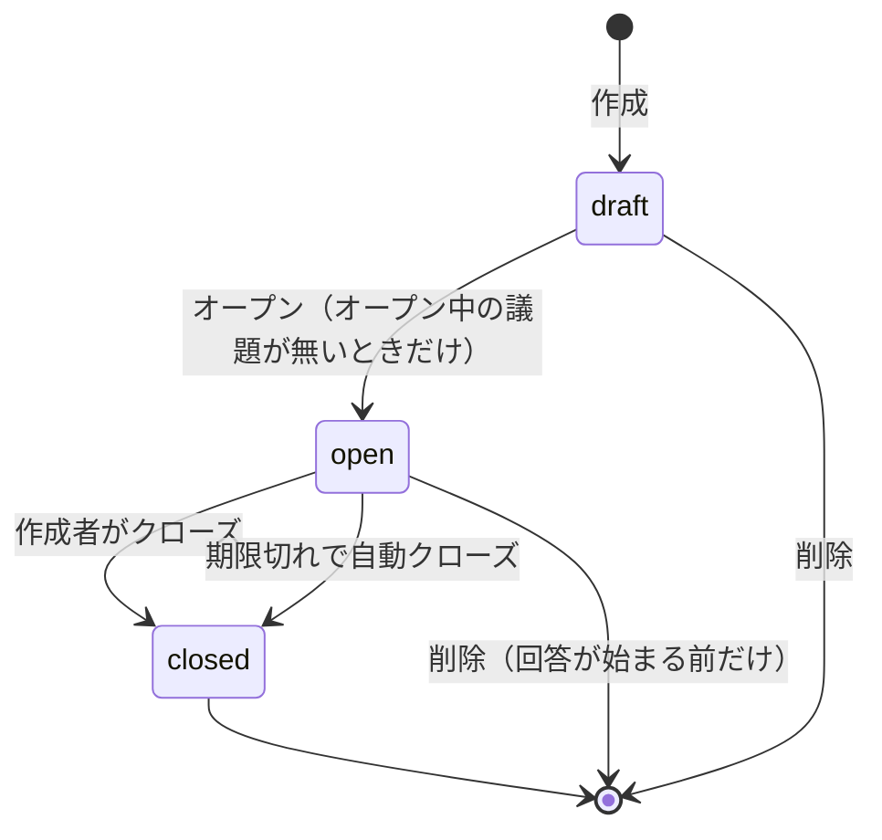
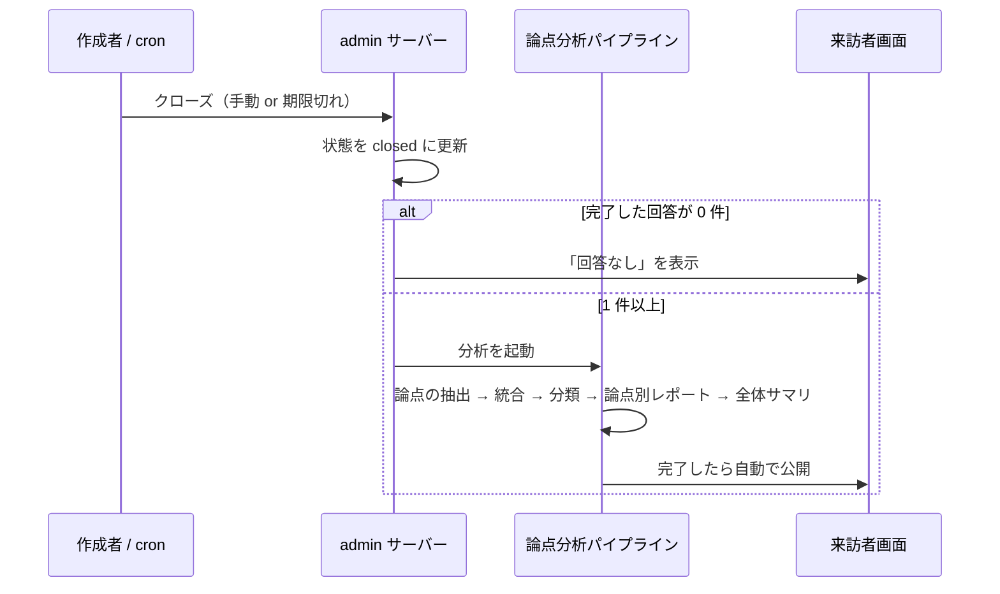

# AIインタビュー広場 機能設計

作成日: 2026-11-12
関連:

- [AIインタビュー広場 設計思想](20261112_2009_AIインタビュー広場_設計思想.md)（各仕様の理由はこちら）
- [法案インタビュー機能DB設計](20251217_1831_法案インタビュー機能DB設計.md) / [実装計画](20251221_1817_法案インタビュー機能実装計画.md)（流用元）
- [管理画面ロール権限設計](20260912_1736_管理画面ロール権限設計.md)
- [実装タスク分割](20261112_2019_AIインタビュー広場_実装タスク分割.md) / [実装チェックリスト](20261112_2019_AIインタビュー広場_実装チェックリスト.md)（どう分けて作るか）

本ドキュメントは、決定済みの仕様と、実装前に決めるべき点を整理したもの。
テーブル定義などの詳細は「案」であり、実装計画を起こす段階で確定する。

---

## 1. 概要

議員・候補者が議題を出し、市民が AI インタビューで答える場を追加する。
来訪者画面では、既存の議会機能と「AIインタビュー広場」を切り替えて使えるようにする。

UI と機能は、既存の議会機能（議案インタビュー・論点分析・検索・Markdown 表示）を踏襲・流用する。

### 用語

| 用語 | 意味 |
|---|---|
| 広場 | AIインタビュー広場。来訪者画面の新しい入口 |
| 議題 | 議員・候補者が出す問い。議案には紐づかない |
| 作成者 | 議題を作った議員・候補者 |
| レポート | クローズ時に自動で作られる、議題全体の集約レポート。回答者1人ごとのレポート（既存の `interview_report`）とは別物 |

---

## 2. 決定事項

| # | 項目 | 決定 |
|---|---|---|
| 1 | 議題を出せる人 | 議員（`legislator`）と候補者（`candidate`）。運営者（`admin`）の扱いは未決（§9） |
| 2 | 議題の状態 | 下書き → オープン → クローズ。逆方向には戻れない |
| 3 | オープン数の上限 | 1人につきオープン状態の議題は1つ |
| 4 | 一覧の並び順 | ランダム。訪問ごとに変わる。ページ間の重複は不可。検索は可能 |
| 5 | レポートの作成 | クローズした時点で自動作成。それ以外のタイミングでは作れない |
| 6 | レポートの公開 | 作成が完了したら自動公開。市民も閲覧できる。作成者は編集・非公開化できない |
| 7 | 再オープン | 不可 |
| 8 | 回答数が少ない場合 | 分析は行う。回答数不足を一覧と本文の両方で明示する。基準は10件未満（設定値） |
| 9 | 回答が0件の場合 | 分析は行わず「回答なし」と表示する |
| 10 | レポートの形式 | 「立場を越えて一致している点」と「割れている点とその理由」を必須にする |
| 11 | 自動クローズ | オープンから30日（設定値）で自動クローズし、レポートを作る |
| 12 | 作成者の表示 | 議題カードとレポートに、名前と会派（候補者はその旨）を必ず表示する |
| 13 | 議題の編集 | 下書き中と、オープン後に回答が始まるまでは可。1人でも回答を始めたら不可 |
| 14 | 議題の削除 | 編集と同じ条件。回答が始まった後は不可 |
| 15 | 議題の本文 | Markdown で書く。来訪者画面では議案と同じ見た目で表示する |
| 16 | 設問の AI 点検 | 入れない |

---

## 3. 議題のライフサイクル



| 状態 | 来訪者画面 | 編集 | 削除 | 回答 |
|---|---|---|---|---|
| 下書き（`draft`） | 表示しない | 可 | 可 | 不可 |
| オープン（`open`）・回答なし | 一覧に表示 | 可 | 可 | 可 |
| オープン（`open`）・回答あり | 一覧に表示 | 不可 | 不可 | 可 |
| クローズ（`closed`） | レポートを表示 | 不可 | 不可 | 不可 |

- 「回答が始まった」は、その議題のインタビューセッションが1件でも作られた時点とする（完了を待たない）。
- クローズは取り消せない。操作の前に「再オープンできないこと」「レポートが自動で公開されること」を示す確認ダイアログを出す。
- クローズすると1枠が空くので、作成者は次の議題をオープンできる。

---

## 4. 来訪者画面（web）

### 4-1. 画面の切り替え

ヘッダー（`web/src/components/header`）とデスクトップメニュー（`web/src/components/layouts/desktop-menu`）に、
「議会」と「AIインタビュー広場」の切り替えを置く。

### 4-2. 画面一覧（案）

| 画面 | パス（案） | 内容 |
|---|---|---|
| 広場トップ | `/plaza` | オープン中の議題の一覧（ランダム）と検索 |
| 議題詳細 | `/plaza/[topicId]` | 議題の本文（Markdown）、作成者、締め切り、インタビュー開始ボタン。クローズ後はレポート |
| インタビュー | `/plaza/[topicId]/interview/...` | 既存の `interview-session` を流用 |
| レポート一覧 | `/plaza/reports` | クローズ済み議題のレポート一覧 |

`app/` 配下の `page.tsx` は薄いラッパーとし、実装は `web/src/features/plaza/` に置く。

### 4-3. 議題カード

- タイトル
- 作成者の名前と会派（候補者は「候補者」）
- 締め切り日
- クローズ済みの場合: 回答数。10件未満なら「回答数不足」のバッジ

### 4-4. 一覧のランダム表示

**要件**: 訪問ごとに並び順が変わる／ページを送っても同じ議題が出ない／検索ができる。

**方式**: 訪問ごとに乱数の種（seed）を発行し、その種で決まる順序で並べる。

1. `/plaza` に seed なしでアクセスしたら、サーバーが seed を発行する。
2. seed はページ送り・検索のリンクに引き継ぐ（URL のクエリ `?seed=...&page=2`）。
3. 並び順は「議題 ID と seed から計算したハッシュ値」の昇順とする。同じ seed なら何ページ目でも順序は同じなので、重複しない。
4. 検索は、絞り込んだ結果を同じ順序で並べる。

```sql
-- 並び順のイメージ。Supabase の JS クライアントは式での並び替えができないので、SQL 関数にする
create function public.list_open_plaza_topics(
  p_seed text,
  p_keyword text default null,
  p_limit integer default 20,
  p_offset integer default 0
) returns setof public.interview_topics
language sql stable as $$
  select t.*
  from public.interview_topics t
  where t.status = 'open'
    and (p_keyword is null or t.title ilike '%' || p_keyword || '%' or t.body_md ilike '%' || p_keyword || '%')
  order by md5(t.id::text || p_seed)
  limit p_limit offset p_offset;
$$;
```

**残る制約**: 閲覧中に議題が増減すると、ページの境界が1件ずれることがある。
増える側は「seed の発行時刻より前にオープンした議題だけを対象にする」ことで防げる。
減る側（閲覧中にクローズされた）は1件飛ぶだけで重複はしないので、許容する。

**検索の対象**: タイトル・本文・作成者名・会派名。既存の `web/src/features/search` の作り（`build-ilike-or-filter`）を流用する。

### 4-5. 議題詳細の Markdown 表示

議案詳細と同じ `parseMarkdown`（`web/src/lib/markdown`）と同じスタイルで表示する。

- サニタイズ（`rehype-sanitize`）・外部リンク・YouTube 埋め込みは既存のまま使える。
- 既存の `parseMarkdown` は議案専用の要素（`LongPressSection` / `DifficultyInfoCard`）を固定の位置に差し込む。
  議題では不要なので、差し込みを無効にできるようにオプションを足す。

### 4-6. インタビュー

既存の議案インタビュー（`web/src/features/interview-session`）を流用する。
議案の内容を前提にした箇所（議案コンテキスト、議案への賛否など）は、議題用に置き換える。

### 4-7. レポートの表示

- 本文の最上部に、作成者・実施期間・回答数を出す。
- 回答数が10件未満の場合は、最上部に「回答が N 件のため、傾向として読むには不十分です」という帯を出す。
- 回答が0件の場合は、分析結果の代わりに「回答なし」と出す。
- 生成中は「レポートを作成中です」と出す。

---

## 5. 管理画面（admin）

### 5-1. 画面（案）

| 画面 | パス（案） | 内容 |
|---|---|---|
| 自分の議題一覧 | `/plaza-topics` | 自分の議題と状態。運営者は全員分 |
| 議題の作成・編集 | `/plaza-topics/new`, `/plaza-topics/[id]/edit` | タイトルと本文（Markdown）。プレビューつき |
| 議題の詳細 | `/plaza-topics/[id]` | 状態、回答数、オープン／クローズの操作、レポート |

### 5-2. 権限

| 操作 | 運営者 | 議員 | 候補者 |
|---|:--:|:--:|:--:|
| 議題の作成・編集・削除 | 未決（§9） | **自分の議題のみ** | **自分の議題のみ** |
| オープン／クローズ | 未決（§9） | 自分の議題のみ | 自分の議題のみ |
| レポートの閲覧 | ○ | ○ | ○ |
| レポートの編集・非公開化 | − | − | − |
| レポート生成の再実行（失敗時） | ○ | − | − |
| 問題のある議題・レポートの取り下げ | ○ | − | − |

- 候補者は現状「閲覧のみ」のロールである。広場では議題の作成ができるようになるので、
  `can-access-page.ts` と権限マトリクス（[ロール権限設計 §4](20260912_1736_管理画面ロール権限設計.md)）を更新する。
- 認可は既存の `requireRole` 系（`admin/src/features/auth/server/lib/auth-server.ts`）に、
  「自分の議題か」の判定を足す。判定は純粋関数として `shared/utils/` に切り出す。
- 議題の作成・編集・オープン・クローズ・削除は `admin_audit_logs` に記録する。

---

## 6. レポートの自動作成

### 6-1. 流れ



- 既存の論点分析（`admin/src/features/topic-analysis`）を流用する。
  現状は運営者がボタンで起動しているものを、クローズ操作から起動する。
- 分析の対象は、クローズ時点で完了しているインタビューだけとする。途中のセッションは含めない。
- 失敗した場合は自動で再実行する。それでも失敗したら、運営者が管理画面から再実行できる。

### 6-2. レポートの形式

全体サマリ（既存の `step5-generate-summary`）の出力に、次の2節を必須にする。

1. **立場を越えて一致している点**
2. **割れている点と、その理由**

賛否の割合は主役にしない。既存の論点分析は論点の抽出と意見の分類まで行っているので、
変更はプロンプトと出力の形（`report-builder`）が中心になる。

### 6-3. 回答数不足の判定

- 基準は「完了したインタビューが10件未満」。定数として持ち、後から変えられるようにする。
- 判定は純粋関数として切り出し、テストを書く。

### 6-4. 自動クローズ

- オープンから30日で自動クローズする。日数は定数として持つ。
- 定期実行は VPS の cron で行う（`infra/cron`。会話ログの削除と同じ仕組み）。
- cron は admin の内部 API を呼び、期限切れの議題をクローズしてレポート作成を起動する。
  内部 API の認証は論点分析と同じ方式（`REVALIDATE_SECRET` の Bearer トークン）とする。

---

## 7. データモデル（案）

### 7-1. `interview_topics`（新設）

```sql
create table public.interview_topics (
  id uuid primary key default gen_random_uuid(),
  author_user_id uuid not null references public.admin_profiles(user_id) on delete restrict,
  title text not null,
  body_md text not null,
  status text not null default 'draft' check (status in ('draft', 'open', 'closed')),
  opened_at timestamptz,
  closes_at timestamptz,          -- 自動クローズの期限（opened_at + 30日）
  closed_at timestamptz,
  closed_reason text check (closed_reason in ('manual', 'expired')),
  created_at timestamptz not null default now(),
  updated_at timestamptz not null default now()
);

alter table public.interview_topics enable row level security;  -- ポリシーは定義しない

-- オープン状態の議題は1人1つ
create unique index interview_topics_one_open_per_author
  on public.interview_topics (author_user_id)
  where status = 'open';

create index interview_topics_status_idx on public.interview_topics (status);
```

- 「1人1つ」はアプリ層の判定に加えて、部分ユニークインデックスで DB でも保証する。
- `author_user_id` は `on delete restrict`。アカウントを消しても議題とレポートが消えないようにする。
  作成者のアカウントを削除する運用をどうするかは未決（§9）。

### 7-2. 既存テーブルとの関係

既存のインタビューと論点分析は、どちらも議案（`bill_id`）に紐づいている。

| テーブル | 現状 | 広場での扱い（案） |
|---|---|---|
| `interview_configs` | `bill_id` が必須 | `bill_id` を任意にし、`topic_id` を追加。どちらか一方だけを持つ制約を付ける |
| `interview_questions` | 設定に紐づく | そのまま使う |
| `interview_sessions` / `interview_messages` / `interview_report` | 設定に紐づく | そのまま使う |
| `topic_analysis_versions` ほか | `bill_id` が必須 | `interview_configs` と同じく `topic_id` を追加 |

別テーブルに分ける案もあるが、インタビューと分析のパイプラインをそのまま使うために、既存テーブルを広げる案を第一候補とする。
議案を前提にしているコードの範囲は、実装計画を起こす段階で調べて確定する。

スキーマを変更するので、マイグレーション・型の再生成（`pnpm db:types:gen`）・`docs/schema/`（`pnpm db:docs`）をセットでコミットする。

---

## 8. 流用する既存機能

| 既存 | 場所 | 広場での使い方 |
|---|---|---|
| AI インタビュー | `web/src/features/interview-session`, `interview-config` | 議題への回答にそのまま使う |
| 論点分析 | `admin/src/features/topic-analysis` | クローズ時の自動レポートに使う |
| Markdown 表示 | `web/src/lib/markdown` | 議題の本文に使う |
| 検索 | `web/src/features/search` | 議題の検索に使う |
| ロールと認可 | `admin/src/features/auth` | 議員・候補者の判定に使う |
| 監査ログ | `admin_audit_logs` | 議題の操作を記録する |
| AI 利用量の制限 | `chat_usage_events` ほか | 広場のインタビューにも同じ制限をかける |
| cron | `infra/cron` | 自動クローズに使う |

---

## 9. 未決事項

実装計画を起こす前に決める。

| # | 論点 | 選択肢 | 推奨 |
|---|---|---|---|
| 1 | オープン中に、作成者に回答の中身を見せるか | 見せる／回答数だけ見せる | **回答数だけ**。中身が見えると、都合のいい時点でクローズできる |
| 2 | インタビューの質問は誰が決めるか | 作成者が質問項目を書く／議題の本文から AI が組み立てる／両方 | 本文を AI に渡し、質問項目は任意で足せる形 |
| 3 | 運営者も議題を出せるか | 出せる／出せない | 出せない。運営者は場を提供する立場のため |
| 4 | 下書きの数に上限を設けるか | 設ける／設けない | 設けない。上限はオープン状態だけにかける |
| 5 | レポート一覧（クローズ済み）の並び順 | ランダム／新しい順 | ランダム。理由はオープン中の一覧と同じ |
| 6 | 回答者1人ごとのレポートを公開するか | 既存と同じく本人の同意で公開／広場では公開しない | 既存と同じ。ただし公開はクローズ後に限る |
| 7 | 作成者のアカウントを削除・ロール変更したときの議題の扱い | 議題を残す／消す | 残す。作成時点の名前と会派を議題に写しておく |
| 8 | 候補者が当選して議員になったとき | オープン中の議題を引き継ぐ／作り直す | 引き継ぐ |
| 9 | レポート生成の自動再実行の回数 | — | 実装時に決める |

### あわせて必要になる作業

- **利用規約・プライバシーポリシー・インタビュー前の説明**: 広場では集約レポートが自動で公開される。
  回答が要約されて公開されることを、回答の前に示す必要がある。
- **ロール権限設計の更新**: 候補者が「閲覧のみ」ではなくなる。

---

## 10. 初版の範囲

**入れる**: §2 の決定事項すべて。

**入れない**（[設計思想 §4](20261112_2009_AIインタビュー広場_設計思想.md) を参照）:

- 設問の AI 点検（採らない）
- インタビュー中に別の立場の理由を示す（次版の候補）
- 自分の意見の位置の表示、回答者の属性の偏りの表示（次版の候補）

---

## 11. テスト方針

- 純粋関数として切り出し、同じ階層に `*.test.ts` を置くもの:
  - 状態遷移の可否（下書き → オープン → クローズ、編集・削除の可否）
  - 「自分の議題か」の認可判定
  - 回答数不足の判定
  - 自動クローズの期限の計算
  - seed の発行と検証
- ランダム表示の SQL 関数は、ローカルの Supabase に接続する結合テストで、
  「同じ seed でページをまたいでも重複しない」「seed が違えば順序が変わる」「検索と併用できる」を確認する。
- 「オープンは1人1つ」は、DB の制約が効くことを結合テストで確認する。
- LLM の呼び出しは、既存と同じくインターフェースを差し替えてテストする。
