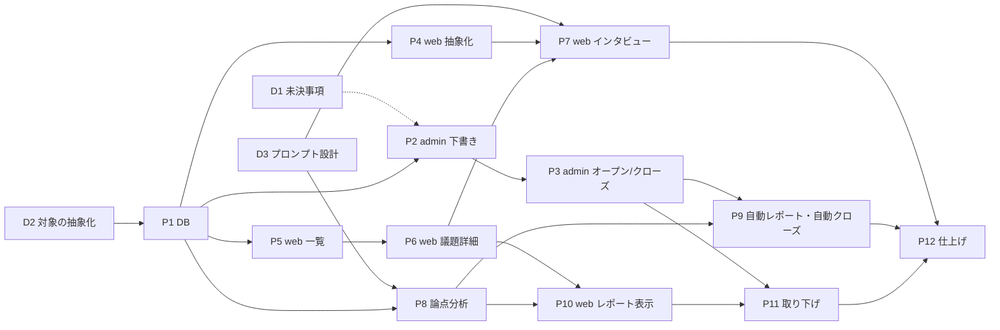

# AIインタビュー広場 実装タスク分割

作成日: 2026-11-12

- 目的: AIインタビュー広場の実装を、**1タスク＝1セッション（＝1ブランチ・1 PR）**の単位に切り分ける。
  1つのセッションに詰め込むとコンテキストが逼迫して精度が落ちるので、考える作業（設計）と作る作業（実装）も分ける
- 位置づけ: 何を作るかの正本は [機能設計](20261112_2009_AIインタビュー広場_機能設計.md)、なぜそうするかの正本は [設計思想](20261112_2009_AIインタビュー広場_設計思想.md)。
  このドキュメントは「どう分けて進めるか」だけを持つ
- 抜け漏れの確認: [実装チェックリスト](20261112_2019_AIインタビュー広場_実装チェックリスト.md)

---

## 0. 使い方

### セッションの始め方

新しいセッションには次のように頼む。

> `docs/20261112_2019_AIインタビュー広場_実装タスク分割.md` の **P3** を実装して

そのセッションは次の順で進める。

1. このドキュメントの §0・§1 と、該当タスクの節（§3）だけを読む。ほかのタスクの節は読まなくてよい
2. 該当タスクの「読むもの」に挙げた箇所を読む
3. [実装チェックリスト](20261112_2019_AIインタビュー広場_実装チェックリスト.md) の §1（着手前）を確認する。
   依存タスクが終わっていない、または「先に決めること」が残っていたら、**着手前にユーザーへ確認する**
4. CLAUDE.md の手順どおり worktree を作る（ブランチ名は各タスクの「ブランチ」欄。
   クラウドのセッションで作業ブランチが指定されている場合は、そのブランチを使う）
5. 作業する。チェックリストの §2（実装中）と §3（種類別）を守る
6. チェックリストの §4（完了前〜PR 後）を上から順に実施する
7. **同じ PR の中で、該当タスクの「状態」行と「完了条件」のチェックを更新する**。ほかのタスクの節は触らない

### 状態の書き方

- `未着手` / `進行中（PR #xx）` / `完了（PR #xx）` / `保留（理由）`
- 完了条件を満たせなかった項目は、チェックを付けずに理由を1行添え、引き継ぎ先のタスクを書く

### 種類

| 種類 | 意味 | 成果物 |
|---|---|---|
| 人 | ユーザーが決める。Claude は選択肢と推奨の整理まで | 決定の記録 |
| 設計 | コードを読んで方針を決める。**実装はしない** | 設計メモ（`docs/` に新規ファイル） |
| 実装 | コードを書く | PR |

設計タスクを分けているのは、広い範囲を読む作業と、狭い範囲を書き換える作業を同じコンテキストに入れないため。

### 公開までの安全策（機能フラグ）

各タスクの PR は `develop` に順次マージされる。途中の状態が本番に出ないように、機能フラグで隠す。

- web: `web/src/config/site.config.ts` の `features.plaza`（P5 で `false` として追加）。`false` の間、広場の画面は 404 を返し、入口も出さない
- admin: 環境変数のフラグ（P2 で追加。`admin/src/lib/utils/is-flag-enabled.ts` を使う）。オフの間、ナビに出さず、画面も開けない
- どちらも **P12 でオンにする**。それまでのタスクでオンにしない

---

## 1. 前提（仮決め）

[機能設計 §9](20261112_2009_AIインタビュー広場_機能設計.md) の未決事項は、推奨案を仮決めとして進める。
**D1 でユーザーが確定する。** 変更があった場合は、この表と影響するタスクの節を D1 の PR で直す。

| # | 論点 | 仮決め | 影響するタスク |
|---|---|---|---|
| K1 | オープン中に作成者へ回答の中身を見せるか | 見せない。回答数だけ見せる | P3 |
| K2 | インタビューの質問は誰が決めるか | 議題の本文を AI に渡す。質問項目の入力画面は初版では作らない（後から足せる構造にしておく） | D3, P3, P7 |
| K3 | 運営者も議題を出せるか | 出せない | P2, P3 |
| K4 | 下書きの数の上限 | 設けない | P2 |
| K5 | レポート一覧（クローズ済み）の並び順 | ランダム | P10 |
| K6 | 回答者1人ごとのレポートの公開 | 既存と同じく本人の同意で公開。ただしクローズ後に限る | P7, P10 |
| K7 | 作成者のアカウント削除・ロール変更時 | 議題は残す。オープン時点の名前・ロール・会派名を議題に写す | P1, P3 |
| K8 | 候補者が当選して議員になったとき | オープン中の議題はそのまま引き継ぐ | P3 |
| K9 | レポート生成の自動再実行の回数 | 2回まで。超えたら失敗として運営者が再実行する | P9 |

設定値（定数として持ち、後から変えられるようにする）:

- 回答数不足の基準: 完了したインタビューが **10件未満**
- 自動クローズ: オープンから **30日**

---

## 2. 全体像

### タスク一覧

| ID | 種類 | 内容 | 依存 |
|---|---|---|---|
| D1 | 人 | 未決事項の確定 | — |
| D2 | 設計 | インタビュー対象の抽象化（議案／議題） | — |
| D3 | 設計 | 議題向けプロンプトの設計 | — |
| P1 | 実装 | DB スキーマ | D2 |
| P2 | 実装 | admin: 議題の作成・編集・削除（下書き） | P1 |
| P3 | 実装 | admin: オープン／クローズ | P2 |
| P4 | 実装 | web: インタビュー対象の抽象化（振る舞いを変えないリファクタリング） | D2, P1 |
| P5 | 実装 | web: 広場トップ（ランダム一覧・ページング・検索） | P1 |
| P6 | 実装 | web: 議題詳細（Markdown 表示） | P5 |
| P7 | 実装 | web: 議題へのインタビュー | D3, P4, P6 |
| P8 | 実装 | admin: 論点分析の議題対応とレポート形式 | D3, P1 |
| P9 | 実装 | クローズ時の自動レポートと自動クローズ | P3, P8 |
| P10 | 実装 | web: レポートの表示 | P6, P8 |
| P11 | 実装 | admin: 運営者による取り下げ | P3, P10 |
| P12 | 実装 | 仕上げと公開 | すべて |

### 依存関係

### 並行して進められる組み合わせ

| 段階 | 同時に進めてよいタスク |
|---|---|
| 1 | D1・D2・D3 |
| 2 | P1（単独。スキーマはほかの全実装の前提） |
| 3 | P2・P4・P5・P8（触る場所が重ならない） |
| 4 | P3・P6 |
| 5 | P7・P9・P10 |
| 6 | P11 → P12 |

マイグレーションを足すタスク（P1・P5・P11 と、必要なら P8）は、ファイル名の日時が前後しないよう、マージの順に気をつける。

---

## 3. タスク

### D1. 未決事項の確定

- **種類**: 人 ／ **依存**: なし ／ **ブランチ**: `docs/plaza-d1-decisions`
- **状態**: 未着手

**読むもの**: [機能設計 §9](20261112_2009_AIインタビュー広場_機能設計.md)、本ドキュメント §1

**やること**

1. §1 の K1〜K9 と設定値（10件・30日）を、選択肢と推奨つきでユーザーに示して確定してもらう
2. 確定した内容で、機能設計 §9 を「決定事項」に書き換える（§2 の表に移す）
3. 仮決めから変わった項目があれば、本ドキュメント §1 と、影響するタスクの節を直す

**完了条件**

- [ ] K1〜K9 と設定値がすべて確定し、機能設計に反映されている
- [ ] 仮決めから変わった項目が、影響するタスクの節に反映されている

---

### D2. インタビュー対象の抽象化（設計）

- **種類**: 設計 ／ **依存**: なし ／ **ブランチ**: `docs/plaza-d2-interview-subject`
- **状態**: 未着手

**背景**: 既存のインタビューと論点分析は、議案（`bill_id`）を前提に作られている。
web では API の入力・設定の取得・プロンプトの組み立てがすべて `billId` を起点にしており、
admin の論点分析も `bill_id` でバージョンを管理し、議案の本文をプロンプトに渡している。
議題でも同じ仕組みを使うには、「議案か議題か」を1か所で吸収する必要がある。

**読むもの**

- [機能設計 §7](20261112_2009_AIインタビュー広場_機能設計.md)（データモデル案）
- [法案インタビュー機能DB設計](20251217_1831_法案インタビュー機能DB設計.md)
- `supabase/migrations/20260530000000_initial_schema.sql` の `interview_configs` / `interview_sessions` / `interview_report` / `topic_analysis_*`
- `web/src/features/interview-config/server/`、`web/src/features/interview-session/server/`、`web/src/app/api/interview/`
- `admin/src/features/topic-analysis/server/repositories/topic-analysis-repository.ts`、`server/services/topic-analysis-orchestrator.ts`

**やること**

1. `bill_id` / `billId` / `BillWithContent` に依存している箇所を、web と admin で洗い出して一覧にする
2. DB の持ち方を決める。第一候補は「`interview_configs` と `topic_analysis_versions` の `bill_id` を任意にし、`topic_id` を足して、どちらか一方だけを持つ制約を付ける」。
   別テーブルに分ける案と比べ、採る案と理由を書く
3. アプリ側の型を決める（例: 議案と議題を同じ形で扱う「インタビュー対象」の型。持つ項目は種類・ID・タイトル・本文・要約）
4. `bill_id` を任意にしたときに既存コードで型エラーになる箇所と、その直し方の方針を書く
5. P1（スキーマ）と P4（web のリファクタリング）と P8（論点分析）が、それぞれ何を変えるかを箇条書きで渡す

**やらないこと**: コードの変更。マイグレーションの作成。

**成果物**: `docs/YYYYMMDD_HHMM_AIインタビュー広場_インタビュー対象の抽象化.md`

**完了条件**

- [ ] 依存箇所の一覧がある（ファイルパスつき）
- [ ] DB の持ち方とアプリ側の型が決まっていて、理由が書いてある
- [ ] P1・P4・P8 への引き継ぎ事項が書いてある
- [ ] P1・P4・P8 の「読むもの」に、成果物のファイル名を追記した

---

### D3. 議題向けプロンプトの設計

- **種類**: 設計 ／ **依存**: なし ／ **ブランチ**: `docs/plaza-d3-prompts`
- **状態**: 未着手

**背景**: 既存のプロンプトは「法案への賛否を聞く」ことを前提にしている。
議題は「子育てで困っていることは何か」のように、賛否で答えられない問いでもよい。
また、レポートは賛否の割合ではなく「論点と理由の地図」にする（[設計思想 2-8](20261112_2009_AIインタビュー広場_設計思想.md)）。

**読むもの**

- [設計思想 §2-5・2-8・2-9](20261112_2009_AIインタビュー広場_設計思想.md)、[機能設計 §6](20261112_2009_AIインタビュー広場_機能設計.md)
- [インタビュー質問設計テクニック](20260221_1400_インタビュー質問設計テクニック.md)、[AIインタビュー終了条件の論点整理](20261010_2142_AIインタビュー終了条件の論点整理.md)
- `web/src/features/interview-session/server/utils/build-interview-system-prompt.ts`、`shared/utils/interview-logic/`、`shared/utils/build-summary-system-prompt.ts`、`shared/schemas.ts`
- `admin/src/features/topic-analysis/server/services/step1〜step5`、`shared/utils/report-builder.ts`、`shared/schemas.ts`

**やること**

1. **インタビュー本体**: 議題の本文を文脈として渡すときのプロンプトを決める。
   事前定義の質問が0件のとき（K2）に、既存の loop / bulk モードがどう振る舞うかを確かめ、議題で使うモードを決める
2. **回答者1人ごとのレポート**: 既存は法案への賛否（`stance`）・役割・スコアを出す。
   賛否で答えられない議題での `stance` の扱い（空にする／別の項目にする）を決める
3. **集約レポート**: 全体サマリに「立場を越えて一致している点」「割れている点とその理由」の2節を必須にする出力形式を決める。
   `stance` が無い場合に「立場」を何から読み取るか（意見の分類結果など）を決める
4. **回答が少ないとき**: 1〜9件でも分析が破綻しないか（バッチ処理・論点の統合）を確かめ、必要な分岐を書く
5. プロンプトの文面の案を、変更前と変更後が分かる形で書く

**やらないこと**: コードの変更。プロンプトの本番反映。

**成果物**: `docs/YYYYMMDD_HHMM_AIインタビュー広場_プロンプト設計.md`

**完了条件**

- [ ] インタビュー本体・個別レポート・集約レポートのそれぞれについて、変更点と文面の案がある
- [ ] `stance` の扱いが決まっている
- [ ] 回答が少ないときの挙動が確かめてある
- [ ] P7・P8 の「読むもの」に、成果物のファイル名を追記した

---

### P1. DB スキーマ

- **種類**: 実装 ／ **依存**: D2 ／ **ブランチ**: `feature/plaza-p1-db`
- **状態**: 未着手

**読むもの**

- [機能設計 §3・§7](20261112_2009_AIインタビュー広場_機能設計.md)
- D2 の成果物
- `supabase/migrations/20260912093442_add_admin_profiles.sql`、`20260923120000_add_admin_audit_logs.sql`（トリガーの書き方）
- `.claude/skills/db-access`

**触る場所**: `supabase/migrations/`、`packages/supabase/types/`、`docs/schema/`、`packages/seed/`、`tests/supabase/`、`bill_id` が任意になって型エラーになる既存コード

**やること**

1. `interview_topics` を作る。機能設計 §7-1 の列に加えて次を持たせる
   - 作成者の写し（K7）: オープン時点の表示名・ロール・会派名
   - 取り下げ（P11 用）: 取り下げ日時・理由
2. RLS を有効にする（ポリシーは定義しない）
3. 「オープンは1人1つ」の部分ユニークインデックスを張る
4. 状態と日時の整合を CHECK 制約で守る（例: `open` なら `opened_at` と `closes_at` が入っている）
5. D2 の決定どおり、`interview_configs` と `topic_analysis_versions` を議題に紐づけられるようにする
6. `interview_topics` の変更が `admin_audit_logs` に残るよう、既存のトリガー関数を対象に加える
7. 型を再生成し（`pnpm db:types:gen`）、`docs/schema/` を更新する（`pnpm db:docs`）
8. 型の変更で壊れた既存コードを、振る舞いを変えずに直す
9. 開発用の seed に、下書き・オープン・クローズの議題を数件ずつ入れる

**やらないこと**: ランダム一覧の SQL 関数（P5）。画面。

**完了条件**

- [ ] マイグレーション・再生成した型・`docs/schema/` が同じ PR に入っている
- [ ] 結合テスト: 同じ作成者でオープンを2つ作れない
- [ ] 結合テスト: 議案と議題の両方に紐づく設定、どちらにも紐づかない設定を作れない
- [ ] 既存の議案インタビューと論点分析のテストが通る
- [ ] `pnpm db:reset` が通り、seed の議題が入る

---

### P2. admin: 議題の作成・編集・削除（下書き）

- **種類**: 実装 ／ **依存**: P1 ／ **ブランチ**: `feature/plaza-p2-admin-draft`
- **状態**: 未着手

**読むもの**

- [機能設計 §3・§5](20261112_2009_AIインタビュー広場_機能設計.md)、[設計思想 2-1・2-2](20261112_2009_AIインタビュー広場_設計思想.md)
- [管理画面ロール権限設計 §3・§4](20260912_1736_管理画面ロール権限設計.md)
- `admin/src/features/auth/shared/utils/can-access-page.ts`、`admin/src/features/auth/server/lib/auth-server.ts`
- `admin/src/features/audit-logs/server/lib/create-audited-admin-client.ts`
- `admin/src/features/bills-edit/client/components/bill-contents-edit-form.tsx`（Markdown の入力の前例）

**触る場所**: `admin/src/features/plaza-topics/`（新規）、`admin/src/app/(protected)/plaza-topics/`（新規）、`admin/src/features/auth/`、`.env.example`

**やること**

1. admin の機能フラグを足す（§0）。オフの間はナビに出さず、画面も開けない
2. `/plaza-topics`（一覧）・`/plaza-topics/new`・`/plaza-topics/[id]`・`/plaza-topics/[id]/edit` を作る。`page.tsx` は薄いラッパーにする
3. `can-access-page.ts` にパスの権限を足す。議員と候補者が開ける（K3: 運営者は閲覧のみ）
4. 一覧は、議員・候補者には自分の議題だけ、運営者には全員分を出す
5. 作成・編集フォーム: タイトルと本文（Markdown）。プレビューつき
6. 「自分の議題か」「編集できる状態か」「削除できる状態か」の判定を純粋関数として切り出し、テストを書く
7. Server Action の先頭で必ずロールと所有者を確認する
8. 書き込みは `createAuditedAdminClient` を使い、実行者を監査ログに残す

**やらないこと**: オープン／クローズ（P3）。レポートの表示（P9・P10）。

**完了条件**

- [ ] 議員・候補者が自分の下書きを作成・編集・削除できる
- [ ] 他人の議題は、画面からも Server Action を直接呼んでも編集・削除できない（テストあり）
- [ ] 運営者は全員分を閲覧できるが、作成はできない（K3）
- [ ] 作成・編集・削除が変更履歴に実行者つきで残る
- [ ] フラグがオフのとき、ナビに出ず画面も開けない
- [ ] 画面のスクリーンショットを PR に貼った

---

### P3. admin: オープン／クローズ

- **種類**: 実装 ／ **依存**: P2 ／ **ブランチ**: `feature/plaza-p3-admin-open-close`
- **状態**: 未着手

**読むもの**

- [機能設計 §3・§5](20261112_2009_AIインタビュー広場_機能設計.md)、[設計思想 2-3・2-6・2-7](20261112_2009_AIインタビュー広場_設計思想.md)
- P2 で作った `admin/src/features/plaza-topics/`
- `admin/src/features/interview-config/server/actions/upsert-interview-config.ts`（インタビュー設定の作り方）
- `admin/src/lib/utils/cache-invalidation.ts`（web のキャッシュ更新）

**触る場所**: `admin/src/features/plaza-topics/`

**やること**

1. 状態遷移を純粋関数にする（下書き → オープン → クローズ。逆は不可）。テストを書く
2. **オープン**: オープン中の議題が無いことを確認する。アプリ層で確認したうえで、DB の制約違反も「すでにオープン中の議題があります」として扱う
3. オープン時に、期限（オープンから30日）と作成者の写し（K7）を保存し、議題用のインタビュー設定を作る（K2: 本文を文脈として渡す。モデルは既定値に固定）
4. **クローズ**: 確認ダイアログで「再オープンできない」「レポートが自動で公開される」を示す
5. **編集・削除のロック**: 回答が始まった（インタビューセッションが1件でもある）議題は、編集も削除もできない。
   画面のボタンを消すだけでなく、Server Action 側でも拒否する
6. オープン中の議題の詳細には、回答数だけを出す（K1）。回答の中身へのリンクは出さない
7. オープン・クローズの後、web のキャッシュを更新する

**やらないこと**: クローズ後のレポート生成の起動（P9。このタスクでは状態を変えるところまで）。自動クローズ（P9）。

**完了条件**

- [ ] 2つ目をオープンしようとすると拒否される（同時に2回押しても1つしかオープンしない）
- [ ] クローズした議題を再オープンする経路が、画面にも Server Action にも無い
- [ ] 回答が始まった議題を、Server Action を直接呼んでも編集・削除できない（テストあり）
- [ ] オープン中の議題で、作成者が回答の中身を見られない（K1）
- [ ] オープン・クローズが変更履歴に残る
- [ ] 画面のスクリーンショットを PR に貼った

---

### P4. web: インタビュー対象の抽象化（リファクタリング）

- **種類**: 実装 ／ **依存**: D2, P1 ／ **ブランチ**: `feature/plaza-p4-web-interview-subject`
- **状態**: 未着手

**読むもの**

- D2 の成果物（これが仕様）
- `web/src/features/interview-config/`、`web/src/features/interview-session/`、`web/src/app/api/interview/`

**触る場所**: `web/src/features/interview-config/`、`web/src/features/interview-session/`、`web/src/app/api/interview/`

**やること**

1. D2 で決めた「インタビュー対象」の型を足す
2. 設定の取得・セッションの作成・プロンプトの組み立て・API の入力を、`billId` 直接ではなくインタビュー対象を受け取る形に変える
3. 議案のインタビューは、これまでと同じ入力で同じ結果になるようにする

**やらないこと**: 議題向けの画面・プロンプトの追加（P7）。**このタスクは振る舞いを変えない。**

**完了条件**

- [ ] 既存の単体テスト・結合テストが、期待値を変えずに通る
- [ ] 議案のインタビューを画面で最初から最後まで通して、変化が無いことを確かめた
- [ ] 議題を渡す口（型と引数）が用意されている

---

### P5. web: 広場トップ（ランダム一覧・ページング・検索）

- **種類**: 実装 ／ **依存**: P1 ／ **ブランチ**: `feature/plaza-p5-web-list`
- **状態**: 未着手

**読むもの**

- [機能設計 §4-1〜4-4](20261112_2009_AIインタビュー広場_機能設計.md)、[設計思想 2-2・2-4](20261112_2009_AIインタビュー広場_設計思想.md)
- `web/src/features/search/`（検索の前例）、`web/src/config/site.config.ts`
- `web/src/components/header/`、`web/src/components/layouts/desktop-menu/`
- `web/src/features/bills/` の一覧とカード（見た目の前例）

**触る場所**: `web/src/features/plaza/`（新規）、`web/src/app/(main)/plaza/`（新規）、`supabase/migrations/`、`web/src/config/site.config.ts`、ヘッダーとメニュー

**やること**

1. `site.config.ts` に `features.plaza: false` を足す。`false` の間、広場の画面は 404、入口は非表示
2. ランダム一覧の SQL 関数を作る（機能設計 §4-4）。引数は seed・検索語・件数・位置。
   seed の発行時刻より後にオープンした議題は含めない
3. seed の発行と検証を純粋関数にする（不正な値は新しい seed に置き換える）。テストを書く
4. `/plaza`: seed が無ければ発行し、ページ送りと検索のリンクに引き継ぐ
5. 検索: タイトル・本文・作成者名・会派名
6. 議題カード: タイトル・作成者の名前と会派（候補者は「候補者」）・締め切り日
7. 「議会」と「AIインタビュー広場」の切り替えをヘッダーとメニューに足す（フラグがオンのときだけ表示）

**やらないこと**: 議題詳細（P6）。レポート一覧（P10）。フラグをオンにすること（P12）。

**完了条件**

- [ ] 結合テスト: 同じ seed で全ページをたどっても、同じ議題が2回出ない
- [ ] 結合テスト: seed が違えば並び順が変わる
- [ ] 結合テスト: 検索語で絞っても、ページ間で重複しない
- [ ] 下書き・クローズ済み・取り下げ済みの議題が一覧に出ない
- [ ] どのカードにも作成者が表示されている
- [ ] 並び順に人気順・新着順が混ざっていない
- [ ] フラグが `false` のとき、`/plaza` が 404 で、入口が出ない
- [ ] 画面のスクリーンショット（スマホ幅とデスクトップ幅）を PR に貼った

---

### P6. web: 議題詳細（Markdown 表示）

- **種類**: 実装 ／ **依存**: P5 ／ **ブランチ**: `feature/plaza-p6-web-detail`
- **状態**: 未着手

**読むもの**

- [機能設計 §4-2・4-5](20261112_2009_AIインタビュー広場_機能設計.md)
- `web/src/lib/markdown/index.ts`、`web/src/features/bills/server/components/bill-detail/bill-content.tsx`
- P5 で作った `web/src/features/plaza/`

**触る場所**: `web/src/features/plaza/`、`web/src/app/(main)/plaza/[topicId]/`、`web/src/lib/markdown/`

**やること**

1. `parseMarkdown` に、議案専用の要素（`LongPressSection` / `DifficultyInfoCard`）の差し込みを無効にするオプションを足す。
   既定の動作は変えない。テストを足す
2. `/plaza/[topicId]`: タイトル・作成者・締め切り日・本文（議案詳細と同じスタイル）・インタビュー開始ボタン
3. 下書き・取り下げ済みの議題は 404 にする
4. クローズ済みの議題では、開始ボタンを出さず、レポートの表示位置を用意する（中身は P10）
5. Markdown のスタイル指定は、議案詳細と共通化して二重に持たない

**やらないこと**: インタビューの画面（P7。開始ボタンの遷移先は P7 でつなぐ）。レポートの中身（P10）。

**完了条件**

- [ ] 見出し・箇条書き・表・リンク・YouTube 埋め込みが、議案詳細と同じ見た目で表示される
- [ ] 本文に書かれたスクリプトや不正な HTML が無害化される（テストあり）
- [ ] 議案詳細の表示が変わっていない（既存テストが通る）
- [ ] 作成者が表示されている
- [ ] 画面のスクリーンショットを PR に貼った

---

### P7. web: 議題へのインタビュー

- **種類**: 実装 ／ **依存**: D3, P4, P6 ／ **ブランチ**: `feature/plaza-p7-web-interview`
- **状態**: 未着手

**読むもの**

- D3 の成果物（インタビュー本体と個別レポートの節）
- [機能設計 §4-6・§9 の「あわせて必要になる作業」](20261112_2009_AIインタビュー広場_機能設計.md)
- `web/src/app/(main)/bills/[id]/interview/`（画面構成の前例）
- `web/src/features/interview-config/server/components/interview-disclosure-page.tsx`、`client/components/interview-consent-modal.tsx`
- `web/src/features/interview-session/server/services/handle-interview-chat-request.ts`

**触る場所**: `web/src/app/(main)/plaza/[topicId]/interview/`、`web/src/features/plaza/`、`web/src/features/interview-session/`、`web/src/features/interview-config/`、`web/src/features/interview-report/`

**やること**

1. 議題のインタビュー画面（開始前の説明・チャット・完了）を、議案のものを流用して作る
2. D3 のプロンプトを、議題のときだけ使うように組み込む
3. 開始前の説明と同意の文面に、**回答が要約されて、クローズ後に自動で公開される**ことを入れる
4. オープンでない議題では、セッションの作成もメッセージの送信も拒否する（画面を開いたままクローズされた場合を含む）
5. 既存の AI 利用量の制限が、議題のインタビューにもかかることを確かめる
6. 個別レポートの公開設定（K6）: 同意の取り方は既存と同じ。ただし公開ページに出るのはクローズ後

**やらないこと**: 集約レポート（P8〜P10）。別の立場の理由を示す機能（次版）。

**完了条件**

- [ ] 議題のインタビューを、開始から完了まで通せる
- [ ] クローズ済みの議題に、API を直接呼んでも回答できない（テストあり）
- [ ] オープン中は、ほかの回答者の回答や集計がどの画面・API からも見えない
- [ ] 開始前の説明に、自動公開のことが書かれている
- [ ] 議案のインタビューが変わっていない（既存テストが通る）
- [ ] LLM の呼び出しは差し替えてテストしている

---

### P8. admin: 論点分析の議題対応とレポート形式

- **種類**: 実装 ／ **依存**: D3, P1 ／ **ブランチ**: `feature/plaza-p8-topic-analysis`
- **状態**: 未着手

**読むもの**

- D2 の成果物（論点分析への引き継ぎ事項）、D3 の成果物（集約レポートの節）
- [機能設計 §6](20261112_2009_AIインタビュー広場_機能設計.md)、[設計思想 2-8](20261112_2009_AIインタビュー広場_設計思想.md)
- `admin/src/features/topic-analysis/` 全体、`admin/src/app/api/topic-analysis/`

**触る場所**: `admin/src/features/topic-analysis/`、`admin/src/app/api/topic-analysis/`

**やること**

1. 分析の対象を、議案だけでなく議題でも指定できるようにする（バージョンの作成・データの取得・フェーズ間の受け渡し）
2. 議題のときは、議案の本文の代わりに議題のタイトルと本文を文脈として渡す
3. 議題のときの全体サマリに、「立場を越えて一致している点」「割れている点とその理由」の2節を必須にする。
   出力の検証（スキーマ）で、2節が欠けていたら失敗として扱う
4. 回答が少ないとき（1〜9件）でも最後まで走るようにする
5. 回答が0件のときは、分析を始めずに「対象なし」として返す（呼び出し側が「回答なし」を表示できるように）

**やらないこと**: クローズからの起動（P9）。web での表示（P10）。議案の分析結果の形式は変えない。

**完了条件**

- [ ] 議題を対象に、分析が最後まで走る（LLM は差し替えてテスト）
- [ ] 全体サマリに必須の2節が無い出力は、失敗として扱われる（テストあり）
- [ ] 1件・9件・0件のそれぞれで、期待どおりに動く（テストあり）
- [ ] 議案の論点分析が変わっていない（既存テストが通る）

---

### P9. クローズ時の自動レポートと自動クローズ

- **種類**: 実装 ／ **依存**: P3, P8 ／ **ブランチ**: `feature/plaza-p9-auto-report`
- **状態**: 未着手

**読むもの**

- [機能設計 §6](20261112_2009_AIインタビュー広場_機能設計.md)、[設計思想 2-5・2-10](20261112_2009_AIインタビュー広場_設計思想.md)
- `admin/src/features/topic-analysis/server/utils/trigger-next-phase.ts`、`admin/src/app/api/topic-analysis/`
- `infra/cron/gikai`、`infra/scripts/delete-expired-chat-logs.sh`、[さくらVPS構築手順](20260930_2104_さくらVPS構築手順.md) の cron の手順
- P3 で作ったクローズの処理

**触る場所**: `admin/src/features/plaza-topics/`、`admin/src/app/api/`、`infra/cron/`、`infra/scripts/`、構築手順のドキュメント

**やること**

1. クローズ（手動）の直後に、論点分析を起動する。0件なら起動しない
2. 期限切れの議題をクローズして分析を起動する内部 API を作る。認証は論点分析の内部 API と同じ方式
3. 内部 API を毎日呼ぶ cron とスクリプトを足し、構築手順に追記する
4. 期限の計算（オープンから30日）と「期限切れか」の判定を純粋関数にして、テストを書く
5. 分析が失敗したら自動で再実行する（K9: 2回まで）。超えたら失敗のまま残す
6. 運営者が、失敗したレポートの生成を管理画面から再実行できるようにする
7. 議題の詳細（admin）に、レポートの状態（作成中・完了・失敗・回答なし）を出す
8. 分析が完了したら、web のキャッシュを更新する

**やらないこと**: レポートの編集・非公開化の機能は**作らない**（[設計思想 2-5](20261112_2009_AIインタビュー広場_設計思想.md)）。

**完了条件**

- [ ] 手動クローズで、分析が自動で始まる
- [ ] 期限切れの議題が、内部 API でクローズされ、分析が始まる（テストあり）
- [ ] 内部 API は、認証が無いと拒否される（テストあり）
- [ ] 内部 API を2回続けて呼んでも、同じ議題の分析が二重に走らない
- [ ] 作成者がレポートの生成を止める・やり直す・隠す経路が無い
- [ ] cron の設定と構築手順が更新されている

---

### P10. web: レポートの表示

- **種類**: 実装 ／ **依存**: P6, P8 ／ **ブランチ**: `feature/plaza-p10-web-report`
- **状態**: 未着手

**読むもの**

- [機能設計 §4-3・4-7](20261112_2009_AIインタビュー広場_機能設計.md)、[設計思想 2-5・2-8・2-9](20261112_2009_AIインタビュー広場_設計思想.md)
- `admin/src/features/topic-analysis/client/components/analysis-report.tsx`、`shared/utils/report-builder.ts`（表示の前例。web には論点分析の表示がまだ無い）
- P6 で作った議題詳細

**触る場所**: `web/src/features/plaza/`、`web/src/app/(main)/plaza/`、`packages/shared/`（定数を共有する場合）

**やること**

1. クローズ済みの議題詳細に、レポートを表示する。最上部に作成者・実施期間・回答数
2. 回答数不足の判定（10件未満）を純粋関数にして、テストを書く。基準は定数にする
3. 回答数不足のとき、本文の最上部に帯を出す。0件のときは「回答なし」。生成中は「レポートを作成中です」
4. `/plaza/reports`: クローズ済み議題の一覧。並び順はランダム（K5。P5 と同じ方式）。
   カードに回答数と、不足のときは「回答数不足」のバッジ
5. 個別レポートの公開ページ（K6）: クローズ後に、本人が同意したものだけを出す
6. レポートは、完了した最新の版だけを表示する。失敗・作成中の版は出さない

**やらないこと**: 自分の意見の位置の表示、回答者の属性の偏りの表示（次版）。

**完了条件**

- [ ] 9件・10件の境界で、帯とバッジの有無が切り替わる（テストあり）
- [ ] 0件・作成中・失敗のそれぞれで、決めた表示になる
- [ ] オープン中の議題では、レポートも個別レポートもどの URL からも見えない
- [ ] レポートに作成者が表示されている
- [ ] 一覧の並び順がランダムで、ページ間で重複しない
- [ ] 画面のスクリーンショットを PR に貼った

---

### P11. admin: 運営者による取り下げ

- **種類**: 実装 ／ **依存**: P3, P10 ／ **ブランチ**: `feature/plaza-p11-withdraw`
- **状態**: 未着手

**読むもの**

- [機能設計 §5-2](20261112_2009_AIインタビュー広場_機能設計.md)、[設計思想 1-3・2-5](20261112_2009_AIインタビュー広場_設計思想.md)
- P1 で足した取り下げの列、P2・P3 の `admin/src/features/plaza-topics/`

**触る場所**: `admin/src/features/plaza-topics/`、`web/src/features/plaza/`

**やること**

1. 運営者だけが、議題（とそのレポート）を取り下げられるようにする。理由の入力を必須にする
2. 取り下げた議題は、web の一覧・詳細・レポート・検索に出さない
3. 取り下げは変更履歴に、実行者と理由つきで残す
4. 取り下げた議題がオープン中だった場合、作成者の1枠が空くかどうかを決めて実装する（決めた内容を PR に書く）

**やらないこと**: 作成者による取り下げ・非公開化（作らない）。

**完了条件**

- [ ] 議員・候補者は、Server Action を直接呼んでも取り下げられない（テストあり）
- [ ] 取り下げた議題が、web のどの画面にも出ない
- [ ] 取り下げが変更履歴に理由つきで残る

---

### P12. 仕上げと公開

- **種類**: 実装（一部は人） ／ **依存**: すべて ／ **ブランチ**: `feature/plaza-p12-release`
- **状態**: 未着手

**読むもの**

- [実装チェックリスト §5・§6・§7](20261112_2019_AIインタビュー広場_実装チェックリスト.md)（このタスクの本体）
- [機能設計 §2・§9 の「あわせて必要になる作業」](20261112_2009_AIインタビュー広場_機能設計.md)
- [プライバシーポリシー・利用規約文案](20260923_2002_プライバシーポリシー・利用規約文案.md)、[管理画面ロール権限設計 §4](20260912_1736_管理画面ロール権限設計.md)

**やること**

1. チェックリスト §5（仕様の対応表）を、コードの実物を見て1行ずつ確認する。満たしていない項目は直す
2. チェックリスト §6（抜け道の確認）を実施する
3. チェックリスト §7（通しの確認）を、ローカルで最初から最後まで実施する
4. 利用規約・プライバシーポリシーに、広場の回答が要約されて公開されることを追記する（文案はユーザーに確認する）
5. ロール権限設計の権限マトリクスに、広場の画面と操作を足す
6. `sitemap.ts` に広場の画面を足す
7. web と admin の機能フラグをオンにする
8. 本ドキュメントの各タスクの「状態」を棚卸しする

**完了条件**

- [ ] チェックリスト §5 の全行にチェックが付いている
- [ ] チェックリスト §6・§7 を実施し、結果を PR に書いた
- [ ] 規約とポリシーの文案を、ユーザーが確認した
- [ ] フラグがオンで、`pnpm lint` / `pnpm typecheck` / `pnpm test` / `pnpm test:integration` が通る
