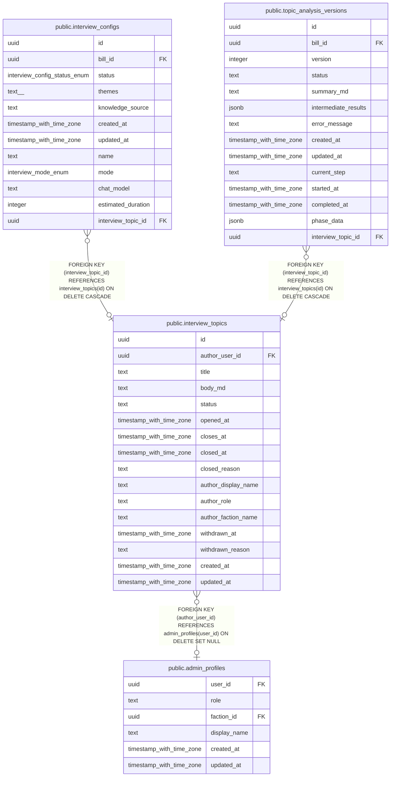

# public.interview_topics

## Description

AIインタビュー広場の議題（議員・候補者が出す問い。議案には紐づかない）

## Columns

| Name | Type | Default | Nullable | Children | Parents | Comment |
| ---- | ---- | ------- | -------- | -------- | ------- | ------- |
| id | uuid | gen_random_uuid() | false | [public.interview_configs](public.interview_configs.md) [public.topic_analysis_versions](public.topic_analysis_versions.md) |  |  |
| author_user_id | uuid |  | true |  | [public.admin_profiles](public.admin_profiles.md) | 作成者のユーザーID（アカウント削除後は null。表示には author_* の写しを使う） |
| title | text |  | false |  |  | 議題のタイトル |
| body_md | text | ''::text | false |  |  | 議題の本文（Markdown） |
| status | text | 'draft'::text | false |  |  | 状態(draft:下書き / open:オープン / closed:クローズ)。逆方向には戻れない |
| opened_at | timestamp with time zone |  | true |  |  | オープンした日時 |
| closes_at | timestamp with time zone |  | true |  |  | 自動クローズの期限（オープン日時 + 設定値の日数） |
| closed_at | timestamp with time zone |  | true |  |  | クローズした日時 |
| closed_reason | text |  | true |  |  | クローズの理由(manual:作成者がクローズ / expired:期限切れで自動クローズ) |
| author_display_name | text |  | true |  |  | オープン時点の作成者の表示名（写し） |
| author_role | text |  | true |  |  | オープン時点の作成者のロール（写し。legislator:議員 / candidate:候補者） |
| author_faction_name | text |  | true |  |  | オープン時点の作成者の会派名（写し。候補者は null） |
| withdrawn_at | timestamp with time zone |  | true |  |  | 運営者が取り下げた日時（null は取り下げていない） |
| withdrawn_reason | text |  | true |  |  | 運営者が取り下げた理由 |
| created_at | timestamp with time zone | now() | false |  |  |  |
| updated_at | timestamp with time zone | now() | false |  |  |  |

## Constraints

| Name | Type | Definition |
| ---- | ---- | ---------- |
| interview_topics_author_snapshot_role | CHECK | CHECK (((author_role IS NULL) OR ((author_role = 'legislator'::text) AND (author_faction_name IS NOT NULL)) OR ((author_role = 'candidate'::text) AND (author_faction_name IS NULL)))) |
| interview_topics_closed_after_open | CHECK | CHECK (((closed_at IS NULL) OR (closed_at >= opened_at))) |
| interview_topics_closed_reason_check | CHECK | CHECK ((closed_reason = ANY (ARRAY['manual'::text, 'expired'::text]))) |
| interview_topics_closes_after_open | CHECK | CHECK (((closes_at IS NULL) OR (closes_at > opened_at))) |
| interview_topics_published_requires_author_snapshot | CHECK | CHECK (((status = 'draft'::text) OR ((author_display_name IS NOT NULL) AND (author_role IS NOT NULL)))) |
| interview_topics_published_requires_body | CHECK | CHECK (((status = 'draft'::text) OR (btrim(body_md) <> ''::text))) |
| interview_topics_status_check | CHECK | CHECK ((status = ANY (ARRAY['draft'::text, 'open'::text, 'closed'::text]))) |
| interview_topics_status_timestamps | CHECK | CHECK ((((status = 'draft'::text) AND (opened_at IS NULL) AND (closes_at IS NULL) AND (closed_at IS NULL) AND (closed_reason IS NULL)) OR ((status = 'open'::text) AND (opened_at IS NOT NULL) AND (closes_at IS NOT NULL) AND (closed_at IS NULL) AND (closed_reason IS NULL)) OR ((status = 'closed'::text) AND (opened_at IS NOT NULL) AND (closes_at IS NOT NULL) AND (closed_at IS NOT NULL) AND (closed_reason IS NOT NULL)))) |
| interview_topics_title_not_blank | CHECK | CHECK ((btrim(title) <> ''::text)) |
| interview_topics_withdrawal_not_draft | CHECK | CHECK (((withdrawn_at IS NULL) OR (status <> 'draft'::text))) |
| interview_topics_withdrawal_pair | CHECK | CHECK ((((withdrawn_at IS NULL) AND (withdrawn_reason IS NULL)) OR ((withdrawn_at IS NOT NULL) AND (withdrawn_reason IS NOT NULL) AND (btrim(withdrawn_reason) <> ''::text)))) |
| interview_topics_author_user_id_fkey | FOREIGN KEY | FOREIGN KEY (author_user_id) REFERENCES admin_profiles(user_id) ON DELETE SET NULL |
| interview_topics_pkey | PRIMARY KEY | PRIMARY KEY (id) |

## Indexes

| Name | Definition |
| ---- | ---------- |
| interview_topics_pkey | CREATE UNIQUE INDEX interview_topics_pkey ON public.interview_topics USING btree (id) |
| interview_topics_one_open_per_author | CREATE UNIQUE INDEX interview_topics_one_open_per_author ON public.interview_topics USING btree (author_user_id) WHERE (status = 'open'::text) |
| interview_topics_status_created_at_idx | CREATE INDEX interview_topics_status_created_at_idx ON public.interview_topics USING btree (status, created_at DESC) |
| interview_topics_author_created_at_idx | CREATE INDEX interview_topics_author_created_at_idx ON public.interview_topics USING btree (author_user_id, created_at DESC) |
| interview_topics_open_closes_at_idx | CREATE INDEX interview_topics_open_closes_at_idx ON public.interview_topics USING btree (closes_at) WHERE (status = 'open'::text) |

## Triggers

| Name | Definition |
| ---- | ---------- |
| update_interview_topics_updated_at | CREATE TRIGGER update_interview_topics_updated_at BEFORE UPDATE ON public.interview_topics FOR EACH ROW EXECUTE FUNCTION update_updated_at_column() |
| interview_topics_audit_log | CREATE TRIGGER interview_topics_audit_log AFTER INSERT OR DELETE OR UPDATE ON public.interview_topics FOR EACH ROW EXECUTE FUNCTION record_admin_audit_log() |

## Relations

---

> Generated by [tbls](https://github.com/k1LoW/tbls)
